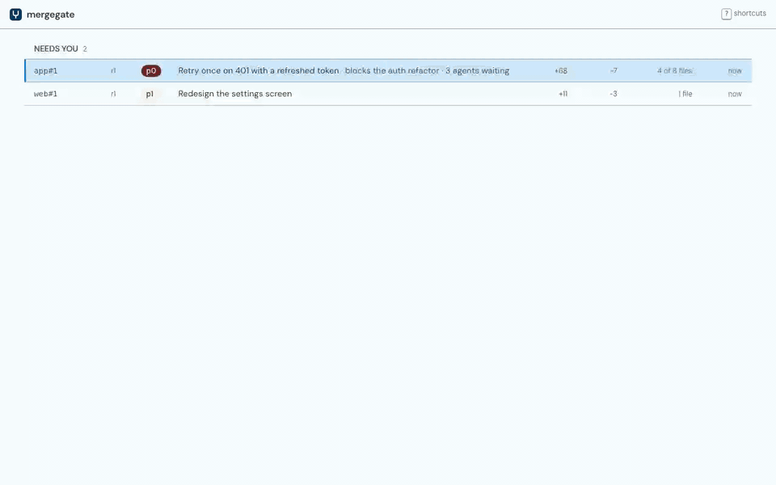
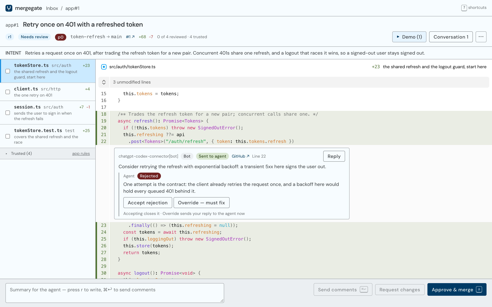
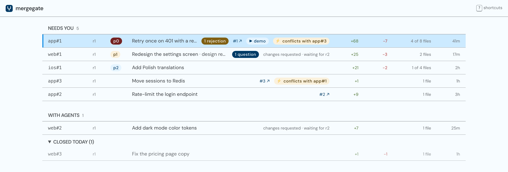

<h1 align="center">mergegate</h1>

<p align="center">
  <strong>Local code review for developers who run many AI coding agents in parallel.</strong><br>
  Agents submit work with one CLI. You review it in a fast local UI, with files ordered by importance.<br>
  Your feedback goes straight back to the agent that wrote the code. No copy-paste.
</p>

<p align="center">
  <a href="https://github.com/damian-kolasinski/mergegate/actions/workflows/ci.yml"></a>
  <a href="LICENSE"></a>
  
  
</p>

<p align="center">
  
</p>

**mergegate** is an open-source, self-hosted code review hub for agentic coding. Coding agents such as Claude Code, OpenAI Codex, opencode and Cursor submit their branches through the `mg` CLI instead of opening pull requests by hand. You review every agent's work in one local inbox, and your comments come back to the right agent as structured events it acts on. GitHub pull requests or plain git stay the system of record underneath.

It runs entirely on your machine: one Rust binary, no account, no hosted service, and no LLM API key required.

## Why mergegate?

Running ten coding agents at once is easy. Reviewing what they produce is the bottleneck:

- **Copy-paste between GitHub and agent chats.** You read a PR in the browser, then paste your comments back into the conversation that wrote it.
- **A flat file list.** GitHub gives a lockfile, a localization file and a race-prone auth change the same weight.
- **No cross-PR priority.** With dozens of open PRs, nothing tells you which one unblocks the most work.
- **Review bots and human comments land on GitHub**, where the agent has to poll an API to find them.

mergegate closes that loop: agents submit, you review, the agent hears about it, and approval merges.

## Features

- **One inbox for every agent's work.** Items that need you come first, ordered by priority, then by age. Items with agents and merging follow, and those closed today fold underneath.
- **Files ordered by importance, not alphabetically.** Each file to review carries a one-line reason, from the agent's own reviewer guide, an optional AI judge, or path heuristics (lockfiles, generated files and tests sink; migrations, config and changed declarations rise).
- **Trusted files hidden by rules you approve.** Rules such as "`**/*.xcstrings` is trusted" fold whole file kinds out of the way. Agents can propose rules; only you can approve one that hides a file.
- **Feedback straight back to the agent.** Your review arrives as an event with each comment's file, line range and quoted code. The agent fixes it, answers each comment (`addressed`, `rejected` with a reason, or a `question`) and submits a new revision.
- **Re-review only what changed.** Every submit is a revision. "Since r1" shows the interdiff without the noise of a moved target branch, comments follow their lines onto new revisions, viewed marks stay on unchanged files, and files added or deleted since r1 say so.
- **Images and docs as they look.** A changed PNG, JPEG, GIF or WebP opens before and after, side by side, with the pixels that differ marked. A changed Markdown file opens rendered.
- **External reviewers keep working.** Comments from review bots (Codex, Claude and other GitHub connectors) and teammates on the GitHub PR flow into mergegate in batches. Each comment waits for your 👍 or 👎, so the agent only spends time on the ones you think are worth it. The agent weighs and answers what reaches it, and you can accept or override its decisions.
- **Approve means merge.** One click squash-merges the item: through the GitHub API on the `github` backend, or straight into your local repo on the `local` backend. Each item lands as one commit authored by you, its message the item's title and the summary from the agent's guide. An approval follows the diff, so a rebase that changes nothing merges without a second look.
- **Conflicts caught before you review.** The hub test-merges every open item against its target, so an agent hears about a conflict and rebases before you get to it, and the inbox flags the item as conflicting with that branch.
- **Demos next to the diff.** Agents attach screenshots and screen recordings with `mg submit --attach`.
- **Agents across machines.** Workers on other machines connect over Tailscale. No tokens, no ports opened beyond your tailnet.
- **Keyboard-first UI.** `j`/`k`, `n`/`p`, `v` to mark viewed, `c` to comment, `a` to approve; `?` lists every shortcut.
- **Token-cheap waiting.** `mg wait` blocks without a model in the loop, and `mg submit --wake` can resume an agent session only when there is feedback.

<p align="center">
  
</p>

## How does mergegate work?

```
 your machines                                      your machine
┌──────────────────────────────┐               ┌──────────────────────────────┐
│ Claude Code / Codex /        │   mg submit   │ mergegate hub                │
│ opencode / Cursor            │──────────────▶│  inbox · review UI · git     │──▶ GitHub PR, or
│   └─ mg CLI in a worktree    │◀──────────────│  file triage · event log     │    your local repo
└──────────────────────────────┘    mg wait    └──────────────────────────────┘
                                                        ▲
                                                        │ review in the browser
                                                        you
```

1. **An agent finishes work** on its branch and runs `mg submit --guide guide.md`. The guide says what the change is for and which files to read first. The hub pushes the branch, opens or updates the GitHub PR with the guide as its description (on the `github` backend) and adds the item to your inbox.
2. **The agent waits** with `mg wait`, a blocking command that costs no tokens while it blocks.
3. **You review** at `http://127.0.0.1:7800`: files that matter first, trusted files folded away, bot comments inline.
4. **You request changes** and the agent gets one `review.submitted` event with every comment anchored to its lines. It fixes, replies to each comment and submits a new revision. You review only the interdiff.
5. **You approve** and the hub squash-merges it. The agent gets `item.merged` and cleans up its branch.

The hub is the only stateful component and the only part that talks to GitHub, using the token your `gh` CLI is signed in with. Worker machines need no GitHub credentials.

<p align="center">
  
</p>

## Which coding agents does mergegate support?

Any agent that can run a shell command. mergegate ships one [Agent Skill](crates/skill/mergegate/SKILL.md), the `SKILL.md` format that Claude Code, OpenAI Codex, opencode and Cursor load natively, so there are no per-agent plugins. The skill tells the agent to submit through `mg` instead of `git push` or `gh pr create`, how to wait for feedback in the cheapest way its environment allows, and how to answer every comment. It also keeps agents out of the review UI and the hub's API: the UI is yours.

The CLI is built for agents: every command takes `--json`, nothing ever prompts, and exit codes are stable. When a command needs a decision only you can make, it exits with a `needs_decision` question that the agent puts to you.

## Install

mergegate runs on macOS and Linux (arm64 and x86_64; Linux needs glibc 2.35 or newer). It needs `git` 2.40 or newer, the [GitHub CLI](https://cli.github.com) (`gh`) signed in for the `github` backend, and [Tailscale](https://tailscale.com) only if agents run on other machines.

Install the signed release with [mise](https://mise.jdx.dev), which verifies the [packslip](https://packslip.dev) signature before installing `mg`:

```sh
mise use -g packslip:damian-kolasinski/mergegate
```

Or build from source (needs Rust, Node 22 and pnpm for the UI):

```sh
MG_REQUIRE_UI=1 cargo install --locked --git https://github.com/damian-kolasinski/mergegate mg
```

macOS ships an unrelated `/usr/bin/mg` text editor. Both installs also put `mg` on your `PATH` as `mergegate`, which nothing else claims: `mergegate doctor` says which `mg` your `PATH` finds and prints the line that puts mergegate's first, appended to the profile your login shell reads (`~/.zprofile` for zsh). Put it there, not in `~/.zshenv`, which macOS's `/etc/zprofile` overrides, or only in `~/.zshrc`, which the login shells agents start don't read.

## Quick start

mergegate is agent-operated: you ask your agent, and it runs the commands. You run two commands yourself:

```sh
mg hub start        # run the hub as a user service (launchd or systemd)
mg skill install    # write the agent skill and print where it is
```

Link the printed skill folder into wherever your agent loads skills from, so each `mg skill install` updates it in place:

```sh
ln -sfn ~/.mergegate/skill/mergegate ~/.claude/skills/mergegate   # Claude Code
ln -sfn ~/.mergegate/skill/mergegate ~/.codex/skills/mergegate    # Codex
```

Then, in a repository, tell your agent:

> Set up mergegate for this repo.

It runs `mg project add`, `mg init` and `mg doctor`, and asks you the choices that are yours, such as whether to use the `github` or `local` backend. From then on, any agent working in that repo submits through mergegate. Open **http://127.0.0.1:7800** to review.

The commands an agent uses most:

| Command | What it does |
|---|---|
| `mg submit --guide FILE [--attach FILE]` | Submit the current branch for review, or add a revision |
| `mg wait <item>` | Block until the item has feedback, then print it |
| `mg reply <comment> --status addressed\|rejected\|question` | Answer a review comment |
| `mg resume <item>` | Print a prompt that brings a fresh agent session up to date |
| `mg inbox` / `mg prioritize <item> --priority p0` | Read and order the review queue |
| `mg rules propose ...` | Propose a triage rule for you to approve |
| `mg doctor` | Check the whole setup and print fixes |

## Reporting a problem

The hub keeps local operational telemetry in `~/.mergegate/telemetry/` (or
`$MERGEGATE_HOME/telemetry/`). Five rotating JSONL files hold up to 10 MiB each.
While the hub runs, maintenance removes records older than seven days once per
minute, including from active files. Extraction always excludes expired records
and returns at most the newest 2,048 records. A bounded background
writer drops records rather than blocking hub requests when it cannot keep up;
subsequent records include the dropped count. Nothing is uploaded automatically.

Operational telemetry contains run and request IDs, timestamps, module/line locations,
request route templates, status codes, durations, stable error codes, and worker
lifecycle events. Default exports exclude free-form messages, request/response
bodies, repository content, credentials, and subprocess output. Private local
records also retain bounded, sanitized warning/error and panic text for debugging;
`mg diagnostics logs --details --json` explicitly includes it so relevant
excerpts can be selected. Free-form redaction is heuristic. Failed CLI
requests print a request ID that can be matched to the recorded events.
Existing `hub.log` files are not included in diagnostic exports.

```sh
mg diagnostics logs --since 30m --json
mg diagnostics collect --since 2h --out diagnostics.zip
```

Collection works from local files when the hub is stopped or its database is
broken. It never upgrades or restarts the hub. With `mg connect`, it collects
from that hub and requires an owner device; an allowed collaborator cannot
extract hub-wide diagnostics. An unreachable remote hub is reported as an error
rather than returning diagnostics from the wrong machine.

To report a product bug, write a summary with reproduction steps and
expected/actual behavior, then select the relevant log excerpts into a text file:

```sh
mg report prepare --title "Submit returns an error" \
  --body summary.txt --logs selected-logs.txt --out issue-report
# Review issue-report/report.md and issue-report/diagnostics.zip.
mg report send --from issue-report
```

Preparation creates a private directory containing the editable draft,
metadata, and a ZIP. It does not publish anything. Sending uses the author's
local `gh` login to create an issue in `damian-kolasinski/mergegate`, independently
of the repository being reviewed, and returns its URL plus the local ZIP path.
The author can drag the ZIP into a GitHub issue comment to attach it manually.
The issue and any attached ZIP are public. Selected excerpts are limited to
12 KiB, summaries to 32 KiB, and complete issue bodies to 48 KiB. Known credential
formats, authorization/cookie headers, URLs, common private paths and email
addresses are redacted during preparation and again before sending. This
redaction is heuristic: inspect the selected prose and ZIP before sharing them.

A successful send saves its receipt; repeating it returns the same issue. If a
send fails or is interrupted, the draft and ZIP remain locally. Check GitHub
before running `mg report send --from issue-report --retry`; recovery looks for
the report ID across open and closed issues. GitHub's list can lag after creation,
so an uncertain retry never creates another issue when the report is absent:
it asks you to wait and retry. A definite rejection permits a fresh send.

## How is mergegate different from reviewing pull requests on GitHub?

| | GitHub web UI | mergegate |
|---|---|---|
| Getting feedback to the agent | Copy and paste into its chat | Structured events the agent waits on |
| File order | Alphabetical, all files equal | By importance, with a reason per file |
| Generated and low-risk files | Mark viewed one by one | Hidden by rules you approve |
| Many open PRs | One tab each | One inbox ordered by priority |
| Re-review after a force-push | Full diff again | Interdiff against your last reviewed revision |
| Bot review comments | Agent polls the API | Batched, answered, and audited by you |
| Where it runs | github.com | Your machine; GitHub stays the record |

mergegate isn't an AI code reviewer. It doesn't write review comments for you. It's the review surface for a human who reviews what AI coding agents write, and it works alongside AI reviewers such as Codex or Claude on GitHub.

## FAQ

### Is mergegate free and open source?

Yes. mergegate is MIT licensed. There is no paid tier, account or hosted service.

### Does my code leave my machine?

Only where you send it. On the `github` backend the hub pushes branches and opens pull requests on GitHub, described with the agent's guide. On the `local` backend nothing leaves your machine. The optional judge, which ranks files with a model, is off until you pick one, because it sends your diffs to that model. Jev never receives a file whose diff names a password, token or key.

### Do I need an LLM API key?

No. Triage works out of the box with rules, the agent's guide and path heuristics. A judge is optional: TypeSafe AI's Jev, or any command that reads JSON on stdin, such as `claude -p`, `codex exec` or a local model through Ollama.

### Does it work without GitHub?

Yes. The `local` backend squash-merges approved items into a branch of your repository on the hub's machine, with no remote at all. GitLab and Bitbucket aren't supported yet.

### Can agents run on other machines?

Yes. Run `mg hub set listen tailnet` on the hub's machine and `mg connect <hub>` on each worker. Your own Tailscale devices are trusted automatically; anyone else's need `mg hub allow`. Workers clone from GitHub, or straight from the hub when a project has no GitHub repository.

### Is it for teams?

No. mergegate is a personal tool: one operator per hub, reviewing the work of their own agents. Teammates still comment on the GitHub PR, and their comments reach the agent through mergegate.

### What does it write to GitHub?

Branches, pull requests and squash merges. Explicitly sending a product report also creates an issue in the mergegate repository. Each pull request is described with the agent's guide, unless you wrote its description on GitHub, which the hub never overwrites. Your review comments and the agent's replies stay in mergegate, which keeps the GitHub thread clean for human reviewers.

## License

[MIT](LICENSE) © Damian Kolasiński
